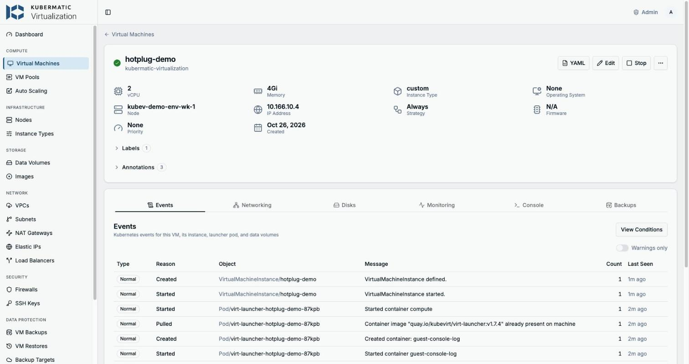
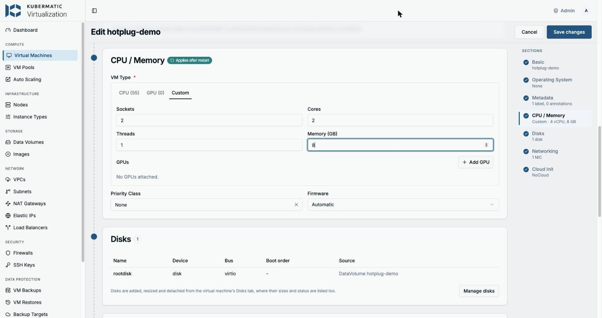
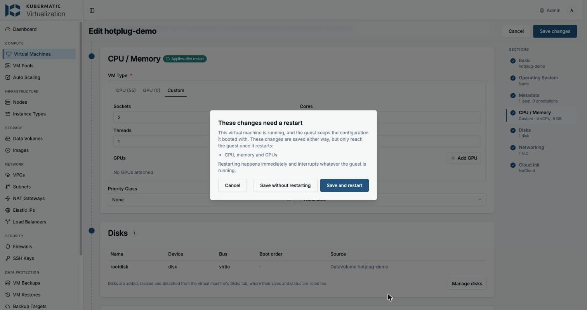
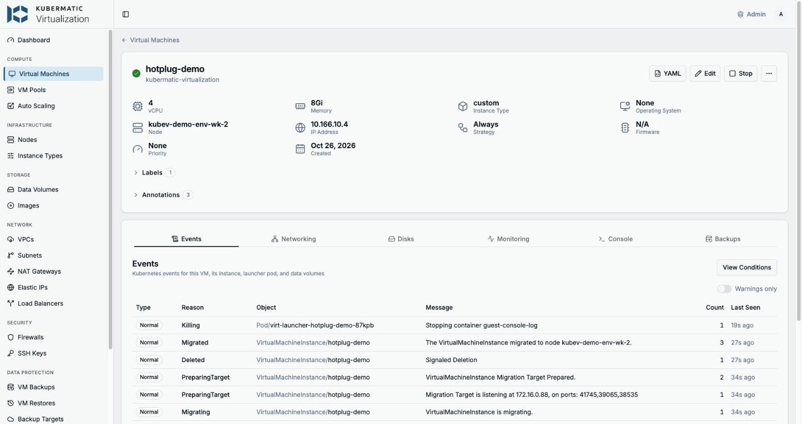
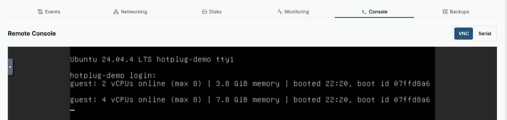

# Live CPU and Memory Hotplug

Give a running VM more vCPUs and memory without a reboot - the vSphere *CPU Hot Plug* / *Memory Hot
Add* question that comes up in every VMware replacement evaluation. KubeVirt 1.7 can do it: it
live-migrates the VM into a bigger virt-launcher pod and plugs the new vCPUs and memory in on the
way. Kubermatic Virtualization (KubeV) v1.3 ships with it switched off.

> [!IMPORTANT]
> **Manual patch, not a product feature.** KubeV v1.3 configures KubeVirt with
> `vmRolloutStrategy: Stage`. `just enable` switches it to `LiveUpdate` by hand - for the whole
> cluster, until `just restore` or the next `kubev apply` reverts it. It is not a supported
> configuration: use it on a demo cluster and say so in the demo.
> Feature request: [kubermatic-virtualization#TBD](https://github.com/kubermatic/kubermatic-virtualization/issues) (Kubermatic-internal).

## What Works

| Change on a running VM                     | KubeV v1.3 default (`Stage`)   | Manual patch (`LiveUpdate`)                                               | Proposed in the feature request               |
|--------------------------------------------|--------------------------------|---------------------------------------------------------------------------|-----------------------------------------------|
| More CPU sockets, up to 4x the boot value  | restart                        | **live**, 20-30 s                                                         | live                                          |
| More memory, VM sized with `memory.guest`  | restart                        | **live**, 20-30 s                                                         | live                                          |
| More memory, VM created in the dashboard   | restart                        | restart - its memory is a pod request                                     | live - the create form writes `memory.guest`  |
| Cores, threads, GPUs, any decrease         | restart                        | restart                                                                   | restart (KubeVirt limit)                      |
| Any change on a VM that can't live-migrate | restart                        | CPU: **evicted** - shut down and booted again, no prompt; memory: restart | CPU change refused or flagged before saving   |
| Hot-added vCPUs inside an Ubuntu guest     | -                              | offline until onlined (udev rule in the demo VM)                          | onlined by the generated cloud-init           |
| VMs already running at the switch          | -                              | one restart to get the headroom                                           | one restart after the upgrade                 |
| Dashboard restart dialog                   | "These changes need a restart" | same static dialog - **Save without restarting** goes live                | live or restart per change, with the headroom |
| Survives `kubev apply`                     | -                              | no                                                                        | yes - an installer setting                    |

*restart* = KubeVirt stores the change, sets `RestartRequired` on the VM and applies it at the next
restart. NIC hotplug is a separate topic and not covered here.

## How It Works

1. With `LiveUpdate`, a VM boots with headroom: `maxSockets` and `maxGuest` at 4x its boot sockets
   and memory, fixed until its next restart.
2. Raising `cpu.sockets` or `memory.guest` makes KubeVirt live-migrate the VM into a virt-launcher
   pod sized for the new values and plug the vCPUs (as new sockets) or the memory (virtio-mem) in on
   the target. The VM keeps its IP, its disks and its boot time. In the self-test each change took
   20-30 s from patch to done, most of it the target pod starting; sockets and memory changed in
   one save go through a single migration.
3. A VM qualifies when it can live-migrate (RWX disk, a migratable network binding, no GPU or host
   device), sets `cpu.sockets` explicitly and sizes memory with `memory.guest` (2Mi-aligned, no
   `resources.requests.memory`). [`hotplug-demo-vm.yaml`](hotplug-demo-vm.yaml) marks these lines
   with `hotplug:`. Its NIC is a bridge on a VPC subnet, wired as the dashboard's create form does
   it: live-migratable, same IP after each migration, and no warnings on the edit page.
4. The guest kernel takes the new memory by itself. Ubuntu leaves hot-added vCPUs offline on KVM
   (its udev rule covers Hyper-V and Xen only), so the demo VM's cloud-init adds one rule:
   ```
   SUBSYSTEM=="cpu", ACTION=="add", TEST=="online", ATTR{online}=="0", ATTR{online}="1"
   ```
5. `virtctl ssh` can't reach into a VPC, so the demo VM reports by itself: whenever its vCPUs or
   memory change, it prints one line to its VNC and serial console, e.g.
   `guest: 4 vCPUs online (max 8) | 7.8 GiB memory | booted 22:20, boot id 07ffd8a6`.
   `just guest` reads the last one from the serial console log. The same boot id before and after
   means no reboot.

## Prerequisites

- `kubectl`, `virtctl`, `jq`, `perl` and [`just`](https://github.com/casey/just)
- A KubeV cluster with 2+ schedulable nodes, a storage class that hands out RWX (here
  `kubev-vms` on Longhorn) and a VPC subnet for the VM's NIC. The VM needs no internet access.
- `KUBEV_KUBECONFIG` pointing at its kubeconfig (default: the kubev-dc demo environment).
  Optional: `KUBEV_NAMESPACE` (`kubermatic-virtualization`), `KUBEV_NETWORK` (the subnet's
  NetworkAttachmentDefinition, `kubermatic-virtualization-tenant-subnet-01-sn`), `HOTPLUG_VM`
  (`hotplug-demo`), `KUBEV_DASHBOARD` (`http://kubev.dc.k8c.io:8080`)

`just preflight` checks all of it and prints the current `vmRolloutStrategy`.

## Demo

### Before the Demo (~3 min)

```bash
just preflight enable create
```

`enable` switches the cluster to `LiveUpdate` and saves the previous value in `.state/` for
`just restore`. `create` builds the demo VM (1 socket x 2 cores = 2 vCPU, 4 GiB, Ubuntu 24.04, NIC
on the VPC subnet) and waits for its first report from inside, ~2 min including the disk import.

### Show It

1. **Starting point** - `just status` shows 2 vCPU, 4Gi and the headroom (max 4 sockets, 16Gi).
   The VM's page in the dashboard shows the same, on its first node:

   

   Its **Console** tab (VNC) and `just guest` show what the guest itself sees, with its boot id:
   `guest: 2 vCPUs online (max 8) | 3.8 GiB memory | booted 22:20, boot id 07ffd8a6`.
2. **Second terminal** - `just watch`: the VM, its headroom and the latest migrations, every 3 s.
3. **Dashboard** - `just ui` opens the VM's edit page. Under **CPU / Memory** set **Sockets**
   1 -> 2 and **Memory (GB)** 4 -> 8; leave Cores and Threads alone, they need a restart.

   

   **Save changes** asks "These changes need a restart". That dialog and the *Applies after
   restart* badge are static in KubeV v1.3, so pick **Save without restarting**.

   
4. **It goes live** - within ~30 s `just watch` shows a migration `Succeeded`, and the VM page
   shows 4 vCPU and 8Gi on the other node with the same IP; its Events tab lists `Migrated`.

   
5. **Proof from inside** - the **Console** tab: the guest printed a new line when the vCPUs and
   memory came in, with the **same boot id** - no reboot. `just guest` prints the same line.

   

Clicked through on kubev-dc on 2026-10-26 (the screenshots above): the save changed exactly two
lines of the VM (`cpu.sockets` 1 -> 2, `memory.guest` 4Gi -> 8Gi), both were live after 29 s
through one migration, and the guest went from 2 to 4 vCPUs and from 3.8 to 7.8 GiB with the same
boot id and IP.

The same from the CLI: `just resize 2 8`, or one at a time `just cpu 2` / `just mem 8`. Each one
follows the change and ends in one line: `LIVE after 26s`, `RESTART REQUIRED: <KubeVirt's reason>`
or `RESTARTED` (evicted). The self-test uses this path.

### Talking Points

- The headroom is 4x the boot size and fixed at boot - size the boot value with that in mind, as
  with vSphere hot-add.
- Every change is a live migration, so the cluster needs a second node with room for the bigger VM.
- Still a restart: cores, threads, GPUs and any decrease.
- A VM that can't live-migrate (RWO disk, GPU, pod-network bridge without the migration
  annotation) is shut down and booted again on a socket change - no prompt, no `RestartRequired`.
  KubeVirt does not check migratability for CPU hotplug, and KubeV's `workloadUpdateMethods`
  include `Evict`. Before resizing any other VM, check it - anything but `True` means a restart:
  ```bash
  kubectl -n kubermatic-virtualization get vmi <name> -o jsonpath='{.status.conditions[?(@.type=="LiveMigratable")].status}'
  ```

## Afterwards

```bash
just cleanup restore
```

`cleanup` deletes the demo VM with its disk; `restore` sets
`vmRolloutStrategy` back to what `enable` found (KubeV default: `Stage`). VMs that booted while
`LiveUpdate` was on keep their `maxSockets`/`maxGuest` until their next restart - harmless, KubeVirt
only acts on them under `LiveUpdate`.

## Recipes

| Recipe               | What it does                                                                       |
|----------------------|------------------------------------------------------------------------------------|
| `preflight`          | cluster, RWX storage, 2+ nodes, local tools; prints the current rollout strategy   |
| `status`             | rollout strategy, demo VMs with their headroom, `RestartRequired`, last migrations |
| `enable` / `restore` | switch the cluster to `LiveUpdate` / put the saved value back                      |
| `create`             | demo VM: RWX disk, 1 socket x 2 cores, `memory.guest` 4Gi, CPU-online udev rule    |
| `cpu N`              | set the sockets of the running VM to N, follow it to LIVE / RESTART REQUIRED       |
| `mem N`              | set `memory.guest` to N GiB, same follow-up                                        |
| `resize N M`         | sockets and memory in one change, like one save in the dashboard                   |
| `ui`                 | open the VM's edit page in the dashboard                                           |
| `guest`              | the guest's own last report: vCPUs online, memory, boot time and boot id           |
| `watch`              | `status` every 3 s, for a second terminal                                          |
| `restart`            | restart the VM - needed once for a VM that booted before `enable`                  |
| `cleanup`            | delete the demo VM and its disk                                                    |
| `e2e`                | the whole story as a self-test, then `cleanup` + `restore`                         |

## Self-Test

`just e2e` runs the whole story against the cluster and puts it back afterwards, also when a step
fails: the KubeV default first (a CPU change waits for a restart), then `enable`, one restart,
three live changes and the guest check, then `cleanup` + `restore`. It refuses to
start unless the cluster is at the KubeV default.

Last run on kubev-dc, 2026-10-26: passed, 7 min including cleanup. Phases 2 and 3:

```
== 2. LiveUpdate on; the running VM restarts once and comes back with the headroom
hotplug-e2e on kubev-demo-env-wk-1: 4 vCPU (sockets 2 x cores 2, max sockets 8) | memory 4Gi (max 16Gi) | live-migratable: True
guest: 4 vCPUs online (max 16) | 3.8 GiB memory | booted 22:29, boot id fd8e2d76
== 3. live hotplug
hotplug-e2e: sockets -> 3
  +7s cpu=2 hotplug=True migration=Scheduling node=kubev-demo-env-wk-1
  +15s cpu=2 hotplug=True migration=Running node=kubev-demo-env-wk-1
  +25s cpu=3 hotplug=none migration=Succeeded node=kubev-demo-env-wk-2
LIVE after 25s: cpu is 3, same VMI, no restart
hotplug-e2e: memory.guest -> 8Gi
  +4s mem=4Gi hotplug=True migration=Pending node=kubev-demo-env-wk-2
  +9s mem=4Gi hotplug=True migration=Succeeded node=kubev-demo-env-wk-2
  +27s mem=8Gi hotplug=none migration=Succeeded node=kubev-demo-env-wk-1
LIVE after 27s: mem is 8Gi, same VMI, no restart
hotplug-e2e: sockets -> 4, memory.guest -> 12Gi
  +3s cpu=3 hotplug=True migration=Scheduling node=kubev-demo-env-wk-1
  +12s cpu=3 hotplug=True migration=Running node=kubev-demo-env-wk-1
  +29s cpu=4 hotplug=none migration=Succeeded node=kubev-demo-env-wk-2
LIVE after 29s: cpu is 4, same VMI, no restart
  +3s mem=12Gi hotplug=none migration=- node=kubev-demo-env-wk-2
LIVE after 3s: mem is 12Gi, same VMI, no restart
guest: 8 vCPUs online (max 16) | 11.8 GiB memory | booted 22:29, boot id fd8e2d76
== e2e passed in 6 min
```

Tested with KubeV v1.3.0, KubeVirt v1.7.4, CDI v1.65.0, Kubernetes v1.34.11, Kube-OVN v1.15.16,
Longhorn v1.10.2 and an Ubuntu 24.04 guest.
